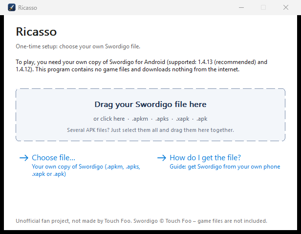

# Ricasso

An unofficial Windows compatibility layer for **your own copy** of the Android game *Swordigo*.

Ricasso is a fan project. It is not made, endorsed or supported by Touch Foo, and it contains **no game files**.

> [!WARNING]
> **This is vibe-coded.** My work on this project (the starter, packaging and cleanup) was written with AI tools
> (Claude and OpenAI Codex), not by hand. It is an experimental hobby project with no warranty, so expect bugs and
> back up your saves. The client and runtime underneath come from
> [SwordigoDesktop](https://github.com/TheAevoraLabs/SwordigoDesktop) by AevoraLabs and the Lawncher Team and are not my work.



## Status

| | |
| --- | --- |
| Stage | 2.0.0 |
| Game versions | Swordigo 1.4.13 (recommended) and 1.4.12, 64-bit (arm64-v8a) |
| Windows | Built and tested on Windows 11 x64. Windows 10 should work but is untested. |
| Testing | Automated client and package tests pass. Gameplay is tested with Swordigo 1.4.13 (keyboard and controller); 1.4.12 is not yet tested in play. |

## Getting started

You need 64-bit Windows, an up-to-date graphics driver and your own copy of Swordigo. No Python, no terminal and no installation are needed.

1. Download `Ricasso-Windows-x64.zip` from the [releases page](../../releases) and extract it (right-click → *Extract All…*).
2. Start `Ricasso.exe`.
3. Choose your Swordigo file or drag it onto the window. Ricasso checks it, copies only what the game needs and offers desktop and Start-menu shortcuts.

The file can be an `.apkm`, `.apks`, `.xapk`, `.apk`, several split APKs or a folder containing them.

### Controls

| | Keyboard | Controller |
| --- | --- | --- |
| Move | A / D or arrow keys | Left stick or D-pad |
| Jump | Space or W | A |
| Attack / magic | see F2 | X / Y |
| Use item | see F2 | B |
| Game menu | Escape | Start |
| Menus and dialogs | Mouse | Right stick moves the pointer, RT clicks |

Every function is in the menu bar at the top of the window; F1 shows or hides it. The tool windows are ordinary Windows dialogs that stay open beside the game: F2 Controls (double-click a binding, then press a key or controller button), F4 Cheats, F6 Graphics, F11 Scene Select. F3 shows the performance overlay and F12 switches fullscreen. *Help → Hotkeys* lists all of them.

### Updating and uninstalling

- When a newer Ricasso release is on GitHub, `Ricasso.exe` shows a button that opens the download page. It asks GitHub at most once a day; set the environment variable `RICASSO_NO_UPDATE_CHECK=1` to turn this off. To update, extract the new ZIP, start `Ricasso.exe` and choose *Reuse previous installation*.
- *Uninstall…* in `Ricasso.exe` removes the shortcuts, the game files Ricasso set up and the Ricasso folder. Your saves in `%APPDATA%\ricasso` stay.

### Where do I get the file?

From your own phone: install Swordigo from Google Play, export it with an app that saves all parts of an app as one file, such as XAPK Extractor (`.xapk`) or [SAI](https://github.com/Aefyr/SAI) (`.apks`), and copy the result to your PC. Apps such as APK Extractor save only the main part (`base.apk`), which does not contain the game itself. Ricasso explains the steps under *How do I get the file?*

Please don't download APK files from third-party websites, and don't share game files. Issues that link to them will be deleted.

## How it works

Swordigo's game library is compiled for ARM64 phones. Ricasso does not rewrite or redistribute the game:

- The client (`swordfare.exe`) loads the original library from your own package and translates its ARM64 code to x64 at runtime with the [Dynarmic](https://github.com/lioncash/dynarmic) JIT recompiler.
- Android itself is not emulated. A loader and a runtime (SRE) replace what the game expects from Android: graphics, audio, files, input and Java calls.

So it is neither an Android emulator nor a source port or static recompilation.

## What it does not do

- **No game files.** Neither this repository nor the releases contain any, and no game artwork either. The images in `src/assets/` are original ([generator](tools/windows/make_original_assets.ps1)).
- **No unlocked purchases.** Every in-app product counts as not purchased, because there is no store on desktop.
- **No ads.** There is no ad service on desktop, so ad requests are answered as "no ad available".
- **No game downloads.** Ricasso uploads nothing and never downloads game files. The only network request is the starter's update check: at most once a day it reads the public list of Ricasso releases on GitHub (`RICASSO_NO_UPDATE_CHECK=1` turns it off). The optional mod store in the client's own launcher, which the starter skips, fetches community mods from a third party.

## Saves, logs and problems

- Saves and settings: `%APPDATA%\ricasso`
- Log: `%LOCALAPPDATA%\Ricasso\logs\latest.log`

| Problem | What to do |
| --- | --- |
| "Windows protected your PC" | The program has no paid code signature. Click *More info* → *Run anyway*, but only if you trust the source. |
| Antivirus reports `swordfare.exe` | The JIT creates code at runtime, which some scanners wrongly flag. Only add an exclusion if you trust the source. |
| The game crashes or won't start | Update your graphics driver. Ricasso shows the cause and the log after a crash. |

For bug reports, please use the issue template and attach `latest.log`. More details: [`WINDOWS_CLIENT.md`](WINDOWS_CLIENT.md).

## Scope of this repository

This is a reduced snapshot of [SwordigoDesktop](https://github.com/TheAevoraLabs/SwordigoDesktop). It contains only what the Windows client and its starter need:

- `src/`, `cmake/`, `include/`, `deps/dynarmic/`, `tests/`: the client, its runtime (SRE) and the client tests
- `tools/windows/`: toolchain bootstrap, build, packaging and verification scripts
- `tools/windows/launcher/`: the starter `Ricasso.exe` (Go)

The editor suite, research tools, documentation and website of the upstream project are not included. The client itself is reduced as well: the in-game Memory Research console, the scene tooling and the OpenSwordigo host mode were removed. Changes are listed in [`SOURCE.md`](SOURCE.md).

## Building

Windows x64 with Python 3.10+, Git, 7-Zip and Go 1.22+:

```powershell
python tools/windows/bootstrap.py
powershell -ExecutionPolicy Bypass -File tools/windows/build.ps1
python tools/windows/verify_package.py
```

The package is written to `dist-windows/Ricasso-Windows-x64.zip`. Python, Go and the toolchain are only needed for building, not for playing.

## License

Ricasso is distributed under the [GNU General Public License v3.0 or later](LICENSE). Parts of the code are MIT-licensed, as described in [`LICENSE.md`](LICENSE.md). Bundled libraries keep their own licenses; their exact sources are listed in [`THIRD_PARTY_SOURCES.md`](THIRD_PARTY_SOURCES.md).

The license covers this code only. It grants no rights to Swordigo.

## Credits

- **Touch Foo / Ville Mäkynen** for Swordigo. Please support the original game.
- **AevoraLabs** and the **Lawncher Team** for SwordigoDesktop, Swordfare and the SRE runtime.
- **Rinnegatamante** and other upstream contributors for earlier porting work.

Full list: [`CREDITS.md`](CREDITS.md).

## Disclaimer

*Swordigo* is a trademark of Touch Foo. Swordigo © Touch Foo. Ricasso is not affiliated with Touch Foo. If you are a rights holder and have a concern about this project, please open an issue.
